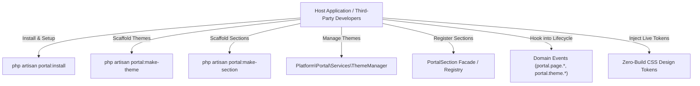

# Developer Extensibility & Architecture Guide (`EXTENDING.md`)

This guide explains how developers can build custom themes, sections, modules, and integrations on top of `bagisto-portal` **without modifying any core package code**.

---

## Architecture Overview



---

## 1. Quick Installation (`portal:install`)

To initialize the portal engine out-of-the-box in any Bagisto installation:

```bash
php artisan portal:install
```

### Options:
- `--force`: Overwrite existing published configuration files.
- `--skip-seed`: Skip seeding sample home page, sections, and menus (recommended for existing production stores).
- `--stubs`: Publish customizable scaffolding stubs to `stubs/portal/` so you can customize what `portal:make-theme` and `portal:make-section` generate.

---

## 2. Theming Engine & Theme Generators

`bagisto-portal` supports two distinct theming paradigms with **Zero Manual Configuration (Auto-Discovery)**:

### 2.1 In-App Themes (`resources/themes/{name}`)
Best for private, project-specific designs:

```bash
php artisan portal:make-theme clinic --title="Clinic Portal"
```

Generates:
- `resources/themes/clinic/theme.php` (Theme metadata and registration)
- `resources/themes/clinic/vite.config.js` (Standalone Vite asset pipeline)
- `resources/themes/clinic/assets/css/app.css` (CSS design tokens)
- `resources/themes/clinic/assets/js/app.js` (JavaScript entrypoint)
- `resources/themes/clinic/views/components/layouts/header/index.blade.php` (Custom header)
- `resources/themes/clinic/views/components/layouts/footer/index.blade.php` (Custom footer)
- `resources/themes/clinic/views/home/index.blade.php`
- `resources/themes/clinic/views/page/show.blade.php`

### 2.2 Reusable Standalone Theme Packages (`packages/{Vendor}/{Theme}`)
Best for distributable, commercial, or open-source Bagisto themes:

```bash
php artisan portal:make-theme Acme/MedicalTheme --package
```

Generates a complete PSR-4 Composer package inside `packages/Acme/MedicalTheme` with its own `composer.json`, `ServiceProvider`, and automatic injection into root `composer.json` and `bootstrap/providers.php`.

### 2.3 Zero-Build Live Design Tokens (Instant Color Updates)
You don't need to run `npm run build` just to change colors or styling!
Whenever a theme overrides `assets/css/app.css`, Portal automatically injects those tokens directly into `<head>`:

```css
:root {
    --brand-primary: #10b981;       /* Changes your store's primary color to Emerald Green */
    --brand-primary-hover: #059669;
    --brand-accent: #f59e0b;        /* Amber accent */
    --bg-app: #f8fafc;
    --bg-surface: #ffffff;
}
```
Save the file and refresh your browser (F5) — the new visual identity is applied **instantly in real time**.

---

## 3. Custom Sections & Visual Customizer

### 3.1 Scaffolding a Section
Create a new section type and its Blade view:

```bash
php artisan portal:make-section PricingTable
```

Creates:
- `app/Portal/Sections/PricingTableSection.php` (Schema, customizer fields, defaults)
- `resources/views/portal/sections/pricing-table.blade.php` (Blade rendering template)

### 3.2 Registering the Section
In your `AppServiceProvider::boot()`:

```php
use App\Portal\Sections\PricingTableSection;
use Platform\Portal\Facades\PortalSection;

public function boot(): void
{
    PortalSection::register(PricingTableSection::class);
}
```

---

## 4. Dynamic Menu Slots

You can insert dynamic navigation slots anywhere in your Blade templates:

```blade
@portalMenuSlot('custom_top_banner')
```

Register new slots in `config/portal.php`:

```php
'slots' => [
    'custom_top_banner' => [
        'label' => 'Top Bar Announcement Menu',
        'location' => 'header',
    ],
],
```

Store administrators can immediately assign any menu to this slot via **Portal > Navigation > Menu Slots**.

---

## 5. Domain Events Reference

External packages can hook into lifecycle events using Laravel's standard `Event::listen()`:

| Event Name | Payload | Description |
| :--- | :--- | :--- |
| `portal.page.creating` | `[PortalPage $page]` | Fired before a portal page is persisted. |
| `portal.page.created` | `[PortalPage $page]` | Fired after a portal page is created. |
| `portal.page.updating` | `[PortalPage $page, array $data]` | Fired before a page is updated. |
| `portal.page.updated` | `[PortalPage $page]` | Fired after page attributes are saved. |
| `portal.page.published` | `[int $pageId]` | Fired when page sections are published live. |
| `portal.page.deleting` | `[int $pageId]` | Fired before a page is deleted. |
| `portal.page.deleted` | `[int $pageId]` | Fired after a page is deleted. |
| `portal.theme.activating`| `[int $channelId, string $themeCode]` | Fired before a theme is switched on a channel. |
| `portal.theme.activated` | `[int $channelId, string $themeCode]` | Fired after a theme is successfully activated. |
| `portal.section.registered` | `[SectionType $section]` | Fired when a custom section type is registered. |
| `portal.section.rendering` | `[PortalPageSection $sec, array &$data]` | Fired before a section is rendered on storefront. |

---

## 6. Model Extensibility (Concord Proxies)

All models implement Concord contracts and proxies. To extend a core model:

```php
namespace App\Models;

use Platform\Portal\Models\PortalPage as BasePortalPage;

class CustomPortalPage extends BasePortalPage
{
    public function customRelationship()
    {
        return $this->hasMany(CustomModel::class);
    }
}
```

In your `AppServiceProvider::boot()`:

```php
$this->app->concord->registerModel(
    \Platform\Portal\Contracts\PortalPage::class,
    \App\Models\CustomPortalPage::class
);
```
