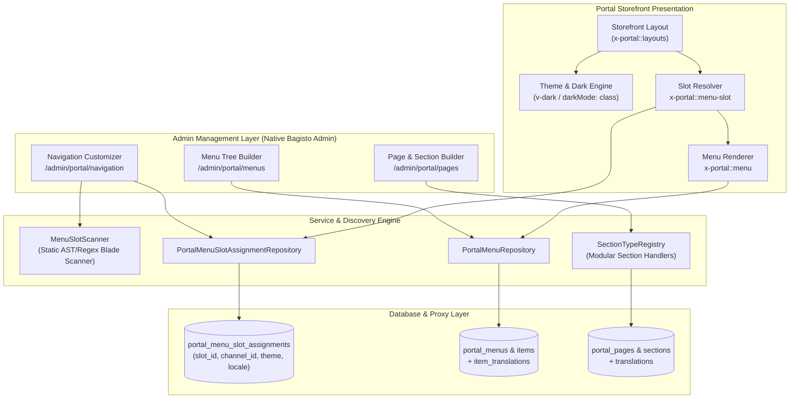
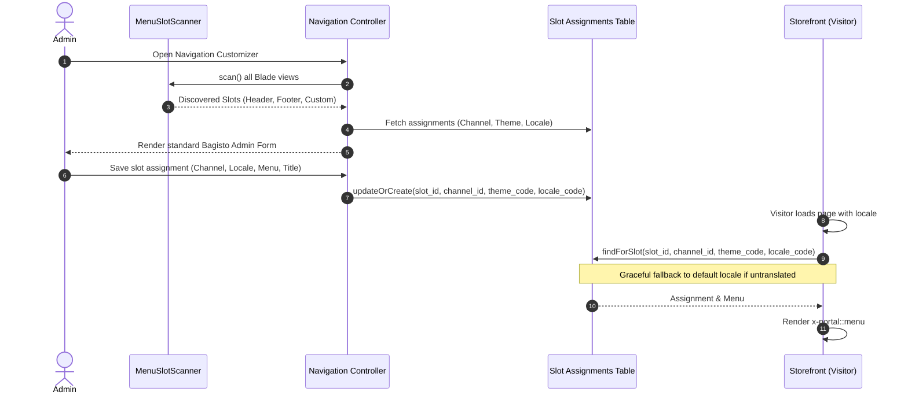

# Bagisto Platform Portal (`platform/portal`)
## Architecture Specification, Developer Guidelines & AI Rules

> **Target Audience**: Human Contributors, Core Maintainers, and Autonomous AI Coding Agents.  
> **Status**: Official Package Standard.  
> **Compatibility**: Bagisto 2.4.x / Laravel 11.x & 12.x / PHP 8.3+.

---

## 1. Package Purpose & Philosophy

The **Portal Package** (`platform/portal`) transforms Bagisto from a rigid e-commerce store into a **domain-agnostic, enterprise-grade content and presentation portal**.

### Key Tenets
1. **No E-Commerce Lock-In**: Storefront presentation, pages, sections, menus, and layouts are decoupled from products and carts.
2. **Zero External Crutches**: Never write ad-hoc styles, custom un-scoped CSS, or foreign JavaScript widgets. Strictly leverage native Bagisto Admin components (`<x-admin::...>`, `<x-portal::...>`) and Vue 3 app instances.
3. **First-Class Multi-Tenancy & Multi-Lingualism**: Every page, section, menu, and slot assignment must be scope-aware (Channel & Locale) with automatic graceful fallback.
4. **Developer Freedom & Component Independence**: Designers and developers can craft any Blade view without design constraints; simply by placing `<x-portal::menu-slot id="..." />`, the system automatically discovers and enables dynamic customization.

---

## 2. System Architecture & Component Diagram



---

## 3. Core Modules & Data Models

### 3.1 Dynamic Menu Slots Engine
Enables developers to declare dynamic navigation containers in any Blade view without hardcoding IDs or styles:



#### Placement in Theme Templates:
```blade
<!-- Header Main Nav Slot -->
<x-portal::menu-slot
    id="header_main"
    location="header"
    class="flex items-center gap-6"
/>

<!-- Footer Column Slot -->
<x-portal::menu-slot
    id="footer_column_1"
    location="footer"
    direction="column"
    class="space-y-2 text-sm"
/>
```

---

## 4. Strict Engineering Guidelines

### 4.1 Bagisto Component Purity Rule
> [!IMPORTANT]
> **NEVER inject raw or external HTML/JS libraries when standard Bagisto components exist.**

- **Admin Layout**: `<x-admin::layouts>`
- **Forms**: `<x-admin::form :action="...">`
- **Dropdowns & Selectors**: `<x-admin::dropdown>`
- **Cards & Accordions**: `<x-admin::accordion>`
- **Form Controls**: `<x-admin::form.control-group>`, `<x-admin::form.control-group.label>`, `<x-admin::form.control-group.control>`, `<x-admin::form.control-group.error>`
- **Modals & Confirmation**: `<x-admin::modal.confirm>`
- **Shimmer / Skeletons**: `<x-admin::shimmer...>`

### 4.2 Multi-Language & Multi-Channel Rules
1. **Always use Core Helpers**:
   - `core()->getRequestedChannel()` for current active channel scope.
   - `core()->getRequestedLocale()` for current active locale scope.
2. **Form Action Query Preservation**:
   - Always pass channel and locale in form action routes:
     ```blade
     <x-admin::form :action="route('admin.portal.navigation.update', ['channel' => $currentChannel->code, 'locale' => $currentLocale->code])">
         <input type="hidden" name="channel" value="{{ $currentChannel->code }}" />
         <input type="hidden" name="locale" value="{{ $currentLocale->code }}" />
     ```
3. **Locale Badges on Form Labels**:
   - Translatable fields must always carry the standard Bagisto locale badge:
     ```html
     <span class="rounded border border-gray-200 bg-gray-100 px-1 py-0.5 text-[10px] font-semibold leading-normal text-gray-600 dark:border-gray-700 dark:bg-gray-800 dark:text-gray-300" v-pre>
         {{ $currentLocale->name }}
     </span>
     ```
4. **Zero Hardcoded Text**:
   - All text strings must strictly reside in `src/Resources/lang/ar/app.php` and `src/Resources/lang/en/app.php`.

### 4.3 Tailwind & Dark Mode Protocol
1. **Tailwind Config**:
   - `darkMode: 'class'` MUST be set in `tailwind.config.js`.
2. **Vue Switcher Component**:
   - Must use the official Bagisto `<v-dark>` component matching `Webkul/Admin`.
   - Never write self-closing custom elements like `<v-dark />` or `<v-theme-switcher />` in Blade because the browser HTML5 parser will swallow subsequent siblings. Always write explicit opening and closing tags `<v-dark></v-dark>`.
   - Always provide SSR static fallback markup inside `<v-dark>` to avoid hydration flicker:
     ```html
     <v-dark>
         <div class="flex">
             <span class="{{ request()->cookie('dark_mode') ? 'icon-light' : 'icon-dark' }} cursor-pointer rounded-md p-1.5 text-xl sm:text-2xl text-gray-700 dark:text-gray-300"></span>
         </div>
     </v-dark>
     ```
3. **Color Tokens**:
   - Backgrounds: Light `bg-white` / `bg-gray-50`, Dark `dark:bg-gray-900` / `dark:bg-gray-950` / `dark:bg-zinc-900`.
   - Borders: Light `border-gray-200` / `border-zinc-200`, Dark `dark:border-gray-800` / `dark:border-zinc-800`.
   - Texts: Light `text-gray-900` / `text-zinc-900`, Dark `dark:text-white` / `dark:text-gray-100`.

### 4.4 Repository Pattern & Proxy Models
Bagisto utilizes Proxy models to allow downstream packages to override models without breaking inheritance.
- Always implement the Contract (e.g. `PortalMenuSlotAssignmentContract`).
- Always create Proxy classes (e.g. `PortalMenuSlotAssignmentProxy`).
- Always register bindings in `ModuleServiceProvider`:
  ```php
  $this->app->bind(
      \Platform\Portal\Contracts\PortalMenuSlotAssignment::class,
      \Platform\Portal\Models\PortalMenuSlotAssignment::class
  );
  ```
- **Eloquent Collection Warning**: When merging keyed Eloquent collections, never use `merge()` as it resets keys via `array_values()`. Use `replace()` to preserve string keys (`slot_id`).

### 4.5 Namespace Isolation & Routing Decoupling
1. **Namespace Purity**:
   - The package strictly owns the `portal` namespace (`portal::views`, `portal::lang`, `<x-portal::...>` components).
   - Never hijack foreign namespaces like `shop::` or register views/components under third-party prefixes.
2. **Coexistence & Routing Modes**:
   - Configured via `config/portal.php` (`PORTAL_ROUTING_MODE`):
     - `override_shop` (default): Portal serves as the primary storefront at `/`, cleanly providing compatibility route aliases.
     - `prefix`: Portal runs alongside `Webkul\Shop` on a dedicated prefix (e.g., `/portal`) without route collision.
3. **Paginator & Middleware Scoping**:
   - Never globally override Laravel's `Paginator::defaultView` or modify the host application's `shop` middleware group. Always encapsulate middleware inside the dedicated `portal` group.

---

## 5. Instructions for AI Coding Agents

When working on `platform/portal`:
1. **Strictly Refrain from Committing**:
   - NEVER execute `git commit` unless the human user explicitly commands you to do so.
2. **Style Verification**:
   - Run Laravel Pint after any PHP change:
     ```bash
     /path/to/bagisto-2.4/vendor/bin/pint /path/to/bagisto-portal/src
     ```
3. **Asset Compilation**:
   - If CSS or JS is touched, always run `npm run build` in `bagisto-portal` and verify Vite compiles assets without warnings.
4. **No E-Commerce Reintroduction**:
   - Do NOT re-introduce hard dependencies on `Webkul\Product`, `Webkul\Cart`, or `Webkul\Checkout` in the core portal flow.

---

## 6. Directory Structure Overview

```text
packages/Platform/Portal/
├── src/
│   ├── Config/              # acl.php, menu.php, portal.php, themes.php
│   ├── Contracts/           # Model contracts for proxy resolution
│   ├── Database/
│   │   └── Migrations/      # Schema migrations
│   ├── Helpers/             # PortalStorefront, PortalAuth helpers
│   ├── Http/
│   │   ├── Controllers/     # Admin (Menus, Navigation, Pages) & Storefront
│   │   ├── Middleware/      # Locale, Currency, StorefrontStatus, Theme
│   │   └── Requests/        # Form requests & validation
│   ├── Models/              # Eloquent models & proxy classes
│   ├── Repositories/        # Database repositories
│   ├── Resources/
│   │   ├── assets/          # CSS, JS (Vite), Fonts, Images
│   │   ├── lang/            # Localization (ar, en)
│   │   └── views/           # Blade templates (admin, storefront, components)
│   ├── Routes/              # admin-routes.php, store-front-routes.php
│   ├── Sections/            # Modular section type handlers & registry
│   └── Services/            # MenuSlotScanner and business services
├── tailwind.config.js       # Tailwind CSS config (darkMode: 'class')
├── vite.config.js           # Vite bundle configuration
└── composer.json            # Package definition
```

