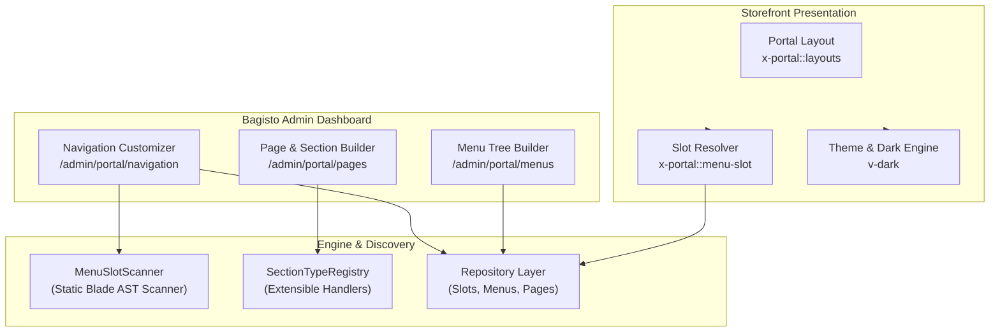

# Bagisto Platform Portal (`platform/portal`)

[](https://github.com/platform/portal)
[](https://bagisto.com)
[](https://laravel.com)
[](LICENSE)

A modern, domain-agnostic presentation portal and content engine for **Bagisto 2.4.x / Laravel 11 & 12**.

Designed as a high-performance, modular replacement or alternative to `Webkul/Shop`, **Bagisto Platform Portal** liberates your Bagisto application from rigid e-commerce constraints. It enables you to build institutional portals, SaaS frontends, enterprise websites, and custom web applications with an **Admin Page & Section Builder**, a **Dynamic Menu & Navigation Customizer**, and **Theme Management** with seamless multi-locale and dark mode support.

---

## 🌟 Key Highlights

- **Domain-Agnostic Storefront**: Pure presentation engine without hard dependencies on products, shopping carts, or checkouts.
- **Dynamic Menu Slot Engine**: Declare `<x-portal::menu-slot id="..." />` anywhere in any Blade view. The AST/regex static scanner automatically detects them and exposes them to the Admin Navigation Customizer.
- **Hierarchical Menu Builder**: Create multi-level, nested menus with custom URLs, target types, icons, and localized labels.
- **Admin Appearance & Section Customizer**: Manage sections dynamically (Hero Banners, Feature Grids, Content Blocks, Testimonials, Footer Columns) with order, activation status, and translations.
- **First-Class Multi-Locale & Multi-Channel**: Native scoping per Bagisto Channel and Locale with automatic fallback to channel defaults.
- **Native Bagisto UI Purity**: 100% built using official Bagisto admin components (`<x-admin::...>`, `<x-portal::...>`) without external CSS frameworks or foreign JS dependencies.
- **Tailwind & Dark Mode Engine**: Built-in cookie-synced dark mode switcher (`<v-dark>`) integrated seamlessly with Tailwind CSS (`darkMode: 'class'`).
- **Independent Asset Pipeline**: Vite-powered standalone asset pipeline bundling CSS, JS, and SVG icons.

---

## 🏗️ Architecture at a Glance



For in-depth architectural details, design rules, and AI development instructions, see [GUIDELINES.md](GUIDELINES.md).

---

## 📦 Installation

### 1. Add Repository Path
Add `platform/portal` to your root Bagisto `composer.json`:

```json
"repositories": [
    {
        "type": "path",
        "url": "../bagisto-portal",
        "options": {
            "symlink": true
        }
    }
]
```

### 2. Require the Package
```bash
composer require platform/portal
```

### 3. Run Migrations & Publish Assets
```bash
php artisan migrate
php artisan optimize:clear
```

### 4. Build Assets (Development / Production)
```bash
cd packages/Platform/Portal # or your bagisto-portal directory
npm install
npm run build
```

---

## 🚀 Usage Guide

### Dynamic Menu Slots

Place dynamic slots in any layout or view. The admin will immediately discover them:

```blade
{{-- Header Navigation Slot --}}
<x-portal::menu-slot
    id="header_main"
    location="header"
    class="flex items-center gap-6"
/>

{{-- Footer Column Slot --}}
<x-portal::menu-slot
    id="footer_column_1"
    location="footer"
    direction="column"
    class="space-y-2 text-sm"
/>
```

When an admin visits **Admin > Portal > Navigation Customizer**, slots appear automatically grouped by location (`header`, `footer`, or `custom`), ready to be assigned to any created menu with locale-specific titles and visibility controls.

### Dark Mode Switcher

Include the standard dark mode toggle matching Bagisto Admin:

```blade
<v-dark>
    <div class="flex">
        <span class="{{ request()->cookie('dark_mode') ? 'icon-light' : 'icon-dark' }} cursor-pointer rounded-md p-1.5 text-xl text-gray-700 dark:text-gray-300"></span>
    </div>
</v-dark>
```

### Creating Custom Section Types

Extend the `AbstractSection` class and register it via `SectionTypeRegistry`:

```php
use Platform\Portal\Sections\AbstractSection;

class HeroSection extends AbstractSection
{
    public function getKey(): string
    {
        return 'hero_slider';
    }

    public function getName(): string
    {
        return 'Hero Slider';
    }

    public function render(array $data, array $config = []): string
    {
        return view('portal::sections.hero', compact('data', 'config'))->render();
    }
}
```

---

## 🛠️ Developer & AI Agent Guidelines

This package strictly follows enterprise Bagisto coding standards:
- **No Direct HTML Overrides**: Always use standard `<x-admin::...>` Blade components.
- **Repository Pattern & Proxies**: All models implement contracts and use Bagisto Proxies.
- **Multi-Tenant State**: Scope queries by `channel` and `locale` via `core()->getRequestedChannel()` and `core()->getRequestedLocale()`.
- **Keyed Collections**: Never use `$collection->merge()` on keyed slot dictionaries; use `$collection->replace()` to prevent key erasure.
- **Formatting**: Run `vendor/bin/pint` prior to any code check-in.

Consult [GUIDELINES.md](GUIDELINES.md) for the complete rules and checklist.

---

## 📄 License

The MIT License (MIT). Please see [License File](LICENSE) for more information.
